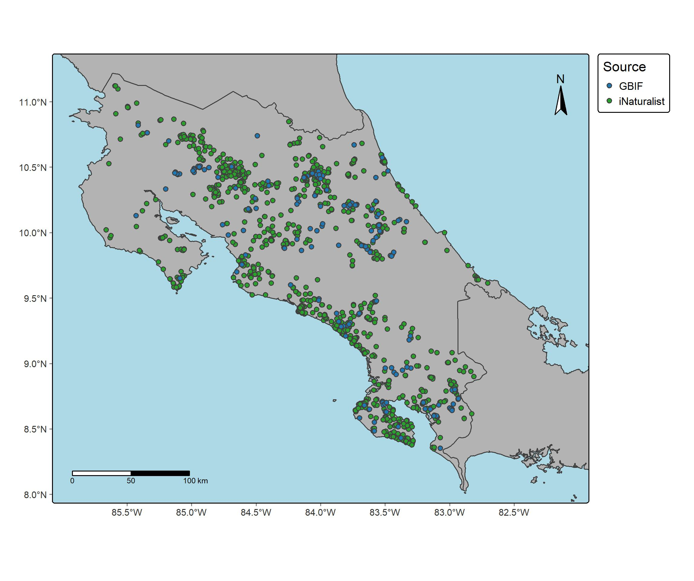

En esta práctica se utilizaron los paquetes rgbif y rinat para descargar ocurrencias de anuros en Costa Rica. Se trabajó con *Craugastor fitzingeri*, la especie de ejemplo del curso, y en paralelo se aplicó el mismo procedimiento a *Espadarana prosoblepon,* la especie de estudio. Para ordenar los datos se usó Tidyverse, y la limpieza de los datos espaciales se hizo principalmente con el paquete CoordinateCleaner. El mapeo de ocurrencias se realizó con los paquetes sf y tmap. El objetivo de esta práctica fue aprender el proceso de descarga de datos de ocurrencia desde una API y su posterior limpieza para crear juegos de datos robustos que puedan utilizarse en análisis espaciales. Después de la limpieza se obtuvo un juego de datos preliminar de *C. fitzingeri* con 3021 ocurrencias, de las cuales 487 provenían de GBIF y 2534 de iNaturalist (Figura 1), estas últimas incluyendo 97 registros con coordenadas oscurecidas. En este ejercicio aprendí las bases de la importación de datos de GBIF e iNaturalist; sin embargo, existe alta heterogeneidad en los datos descargados y el proceso de limpieza es complejo. Una ventaja es que los códigos utilizados funcionan para cualquier clado y en cualquier región, como se comprobó al aplicarlos también a *E. prosoblepon*.

