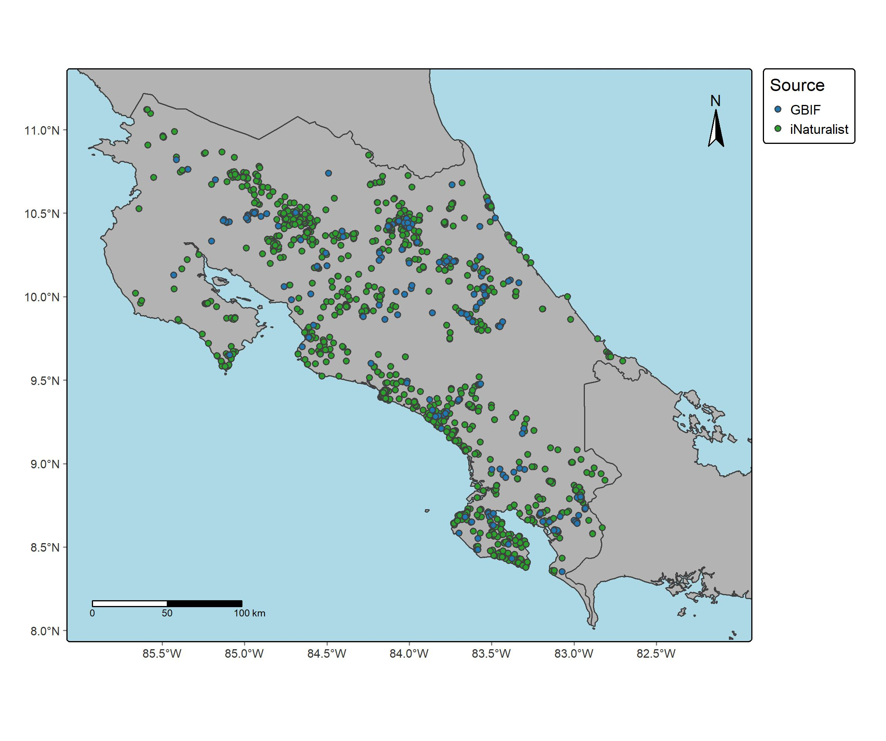

En esta practica se utilizaron los paquetes de rgbif y rinat para descargar ocurrencias de la especie de anuro *Craugastor fitzingeri* en Costa Rica. Para el ordenamiento de datos se utilizó el paquete Tidyverse para la limpieza de datos espaciales, donde se utilizó principalmente el paquete CoordinateCleaner. El mapeo de ocurrencias se realizó con los paquetes sf y tmap. El objetivo de esta practica fue aprender el proceso de descarga de datos de ocurrencia desde un API y su posterior limpieza para crear juegos de datos robustos que puedan utilizarse en análisis espaciales. Posterior a la limpieza se construyó un juego de datos preliminar de (poner ocurrencias), de las cuales (poner numero) pertenecían a GBIF y (poner numero) pertenecían a iNaturalist (Figura 1). En este ejercicio aprendí las bases de la importación de datos de GBIF y iNaturalist, sin embargo, existe alta heterogeneidad en los datos descargados y el proceso de limpieza es complejo. Una ventaja es que os códigos utilizados funcionan para cualquier clado y en cualquier región.

