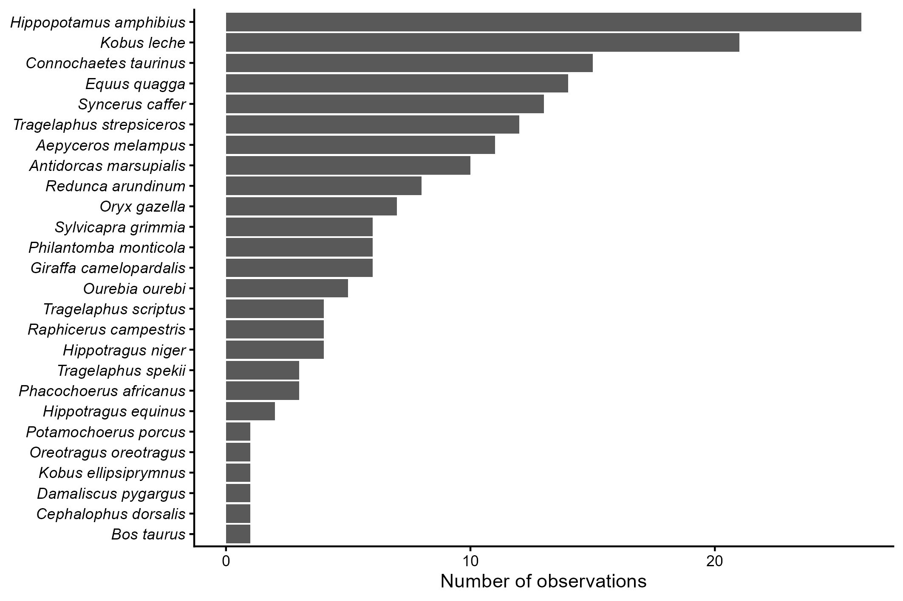

## Introducción

En esta práctica se utilizó el paquete "Tidyverse" en para realizar el proceso de importación de datos, así como la limpieza, manipulación y visualización de datos. El juego de datos del estudio consistió en una seria de observaciones de mamíferos africanos que se encontraba desordenado o que carecía de formato.

## Objetivo

El objetivo de esta práctica fue importar, ordenar y visualizar un juego de datos de mamíferos africanos utilizando Tidyverse, que es una colección de paquetes de R diseñados para la ciencia de datos que comparten una filosofía, gramática y estructura de datos común.

## Metodología

Se importó un juego de datos y se realizó una manipulación de datos con Tidyverse que incluyó el resumen de datos, cambio de formato de fecha, unión y separación de columnas, y un gráfico para visualizar la abundancia relativa de observaciones.

## Resultados

Se encontró un total de 26 especies. La especie más abundante fue el hipopótamo, *Hippopotamus amphibius,* con 28 observaciones, seguido del antílope de Lechwe, *Kobus leche*, con 22 observaciones (Figura 1).

## Conclusiónes

En este ejercicio aprendí las bases de la importación y manejo de datos en Tidyverse; sin embargo, se necesita mucha más practica para dominar la gran cantidad de funciones que se incluyen en este conjunto de paquetes. La versatilidad que ofrece el universo del paquete de Tidyverse permite utilizar este proceso en cualquier tipo de juego de datos, por lo que es una herramienta muy valiosa para los ecólogos.
